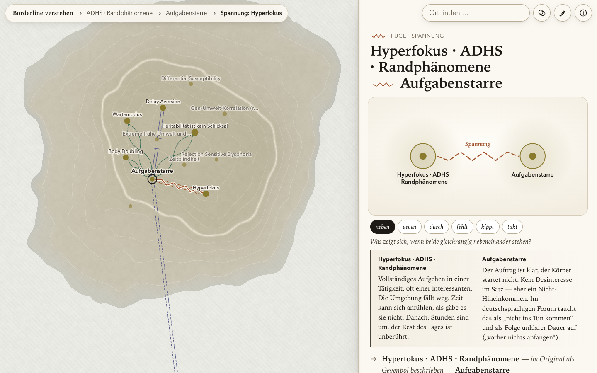
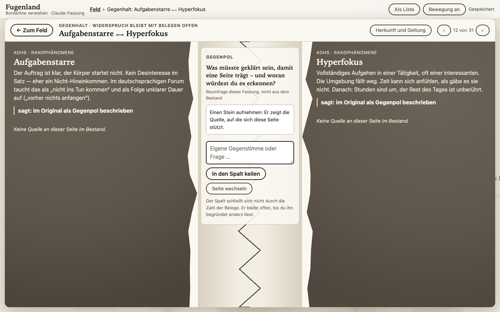
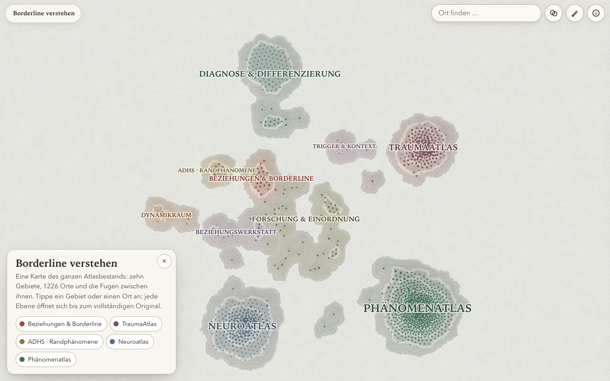
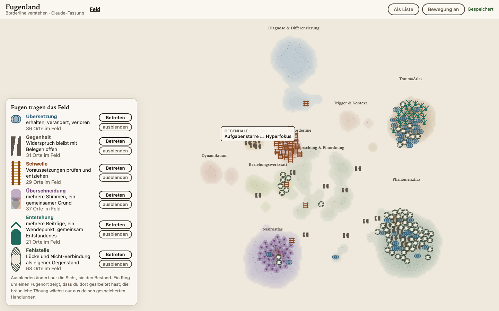

# Fugenland · vorher und nachher

Vorher ist der von Ralf am 4. November 2026 abgelehnte Stand. Er ist als Git-Tag `abgelehnt-20261104` erhalten. Nachher ist Fugenland 2 vom selben Tag. Die Bilder liegen in `evidence/vorher-nachher/`. Dieser Vergleich ist ein technischer und gestalterischer Befund dieser Fassung. **Die menschliche Abnahme steht aus.**

## Dieselbe Fuge: Aufgabenstarre ⟷ Hyperfokus (Gegenpol)

| Vorher | Nachher |
| --- | --- |
|  |  |
| Zwei gleich gebaute Kreise mit einer Zickzacklinie dazwischen. Darunter sechs Umschalter (neben, gegen, durch, fehlt, kippt, takt), die dieselben zwei Texte umstellen. Ein Textblatt neben der Karte. | Ein **Gegenhalt-Raum**: zwei Felsmassen mit Bruchkante, dazwischen ein offener Spalt mit der Raumfrage. Belege wären Steine, aber diese Fuge hat im Bestand keine Quelle, und das steht sichtbar da. Eigene Gegenstimmen werden in den Spalt gekeilt, „Seite wechseln“ spiegelt den Raum. |

## Das Feld

| Vorher | Nachher |
| --- | --- |
|  |  |
| Archipel mit 1831 Kanten als Kurven zwischen Orten. Die Fugenart unterschied sich nur durch Strich und Farbe. | Keine Kantenlinien. Das Gelände entsteht aus der Ortsdichte. Darauf stehen 217 Fugenorte, und jede Art hat ein eigenes Zeichen: Bruchblöcke, Tor mit so vielen Riegeln wie Grenzen, Linsenpaar, Membranen, Zusammenfluss, schraffierte Kammer. Die bräunliche Reifung wächst nur aus gespeicherten Handlungen. |

## Was sich grundsätzlich geändert hat

| Kritik vom 4. November | Vorher | Nachher |
| --- | --- | --- |
| „nur gleich aussehende Verbindungen, Bananengraphen“ | 15 Fugenarten, alle als Kurve von A nach B | Sechs Raumarten und eine Herkunftsebene, jede mit eigenem Aufbau. Die Prüfung misst die Verschiedenheit (eigene Wurzelklasse; SVG, Knöpfe und Eingaben je Raum verschieden). |
| „nicht Fugen mit unterschiedlichsten Funktionen“ | Eine Funktion: Text lesen, Darstellung umschalten | Übersetzung: Wörter in Becken legen. Gegenhalt: Belege aufnehmen, Gegenstimme keilen. Schwelle: Riegel ziehen und prüfen. Überschneidung: Stimmen zu- und abschalten. Entstehung: Beiträge, Wendepunkt, Gemeinsames. Fehlstelle: Lücke einordnen, Nicht-Verbindung begründen. Herkunft: Schichten lesen, Schlussproben ansetzen. |
| „die beiden Fugen-Apps nicht angeschaut“ | Nur Quellen gelesen | Heute bedient: Kimi-Fugenbank mit allen sechs Funktionen, Zusammenführung B, Stufe C, ChatGPT-FUGE mit Reibung, Kimi-Welt mit Begegnung. Gesichtet: das Grok-Bild „Schwelle trägt“, Antigravity-Membranen. Nachweis in `docs/HERKUNFT-DER-IDEEN.md`. |
| Zwei Beteiligte | Jede Kante hat genau zwei Enden | Überschneidung: bis zu sechs Stimmen gleichzeitig. Entstehung: bis zu drei Herkünfte und mehrere Nachfolger. Fehlstelle: ein Rand aus bis zu 189 Kanten. |
| Lebendigkeit | Bewegung als Zierde (fließen, zittern) | Bewegung nur bei Flug, Entfaltung und Ausbreitung nach einer eigenen Handlung. Ohne Handlung ruht das Feld. |
